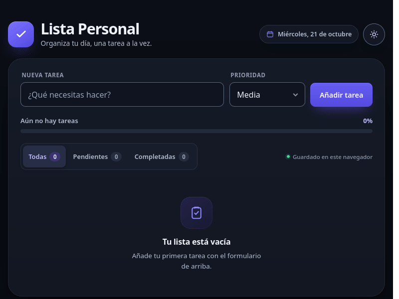
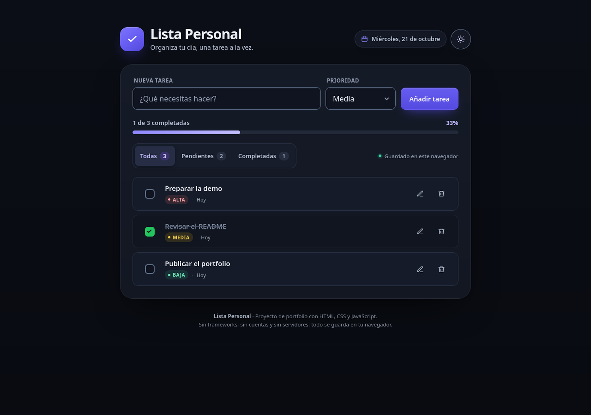
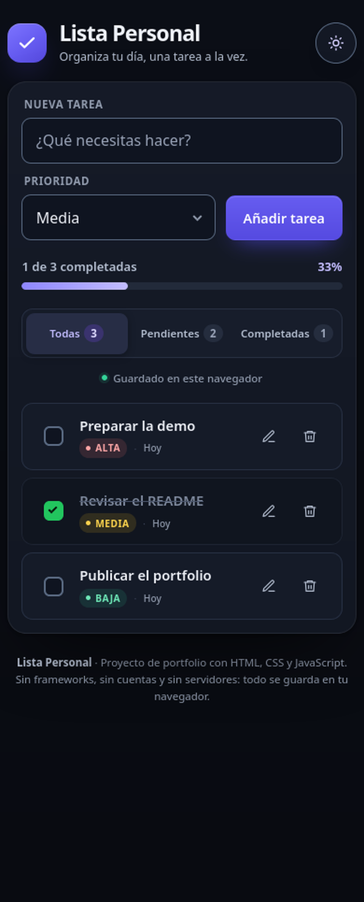
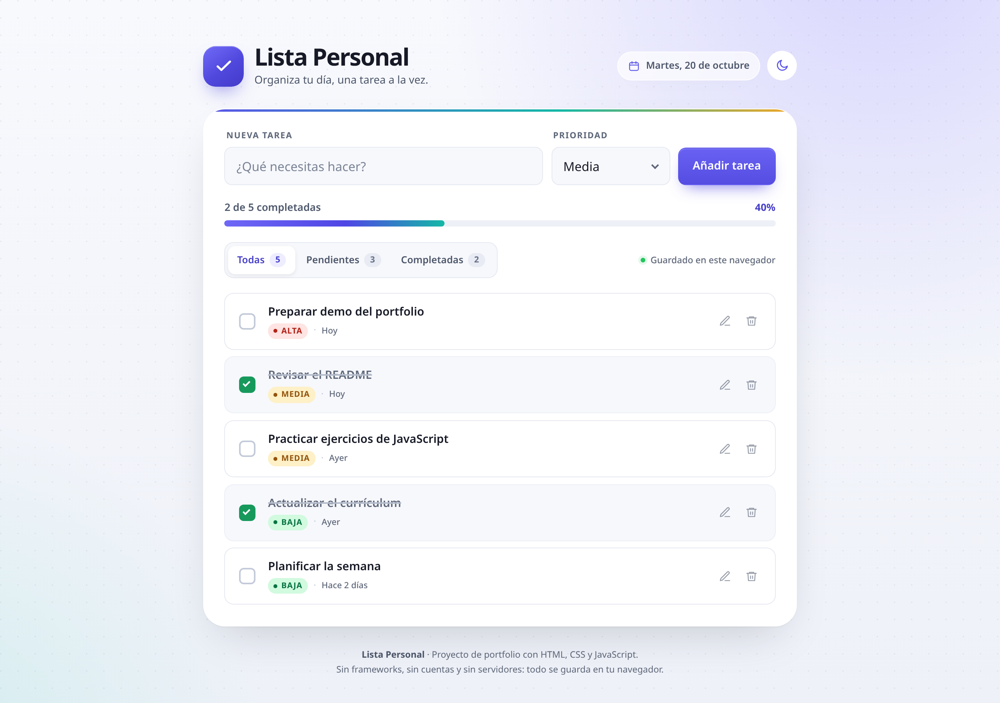

# Lista Personal

Gestor de tareas ligero y responsive hecho con **HTML, CSS y JavaScript vanilla**. Sin frameworks, sin dependencias y sin backend: las tareas se guardan en el navegador mediante `localStorage`.

**Modo oscuro por defecto**, con un botón para cambiar a modo claro. La preferencia también se guarda.

**Demo:** [https://sburgos28.github.io/lista-personal/](https://sburgos28.github.io/lista-personal/)





<details>
  <summary>Ver modo móvil</summary>
  <br>
  
</details>

<details>
  <summary>Ver modo claro (opcional)</summary>
  <br>
  
</details>

## Funcionalidades

- Crear tareas con prioridad **alta**, **media** o **baja**.
- Editar el título y la prioridad de una tarea.
- Eliminar tareas con diálogo de confirmación.
- Marcar tareas como completadas o volver a marcarlas como pendientes.
- Filtros **Todas / Pendientes / Completadas** con contador dinámico.
- Barra de progreso y resumen de tareas completadas.
- Persistencia en `localStorage`: las tareas siguen ahí al recargar.
- **Tema oscuro por defecto** y **modo claro opcional** con preferencia persistente.
- Diseño adaptable a móvil, tablet y escritorio.
- Navegación por teclado, foco visible y avisos accesibles con `aria-live`.
- Sin dependencias externas ni proceso de compilación.

## Tecnologías

- **HTML5** semántico y `<template>` para la plantilla de cada tarea.
- **CSS3**: variables, Grid, Flexbox, `clamp()`, media queries, `data-theme` y `prefers-reduced-motion`.
- **JavaScript (ES2022+)**: módulos ES, programación funcional básica, event delegation, `crypto.randomUUID`.
- **localStorage** para persistir tareas y preferencia de tema.
- **`<dialog>`** nativo para la confirmación de borrado.

## Estructura del proyecto

```text
lista-personal/
├── index.html              # Estructura, template de tarea y diálogo
├── css/
│   └── styles.css          # Sistema visual, temas, responsive y accesibilidad
├── js/
│   ├── constants.js        # Constantes compartidas (claves, prioridades, límites)
│   ├── storage.js          # Lectura/escritura de tareas en localStorage
│   ├── taskStore.js        # Estado y reglas de negocio (CRUD, sin DOM)
│   ├── ui.js               # Renderizado seguro y accesible
│   ├── theme.js            # Tema oscuro/claro y persistencia de la preferencia
│   └── app.js              # Eventos, filtros y conexión de las capas
├── assets/
│   ├── demo.gif
│   ├── favicon.svg
│   ├── preview.png
│   ├── preview-mobile.png
│   └── preview-light.png
├── LICENSE
└── README.md
```

### Flujo de una acción

```text
Usuario → app.js → taskStore.js → storage.js (localStorage)
                        │
                        └── refresh() → ui.js → DOM

Botón de tema → theme.js → data-theme en <html> + localStorage
```

- `app.js` interpreta la intención del usuario.
- `taskStore.js` valida y modifica los datos.
- `storage.js` los persiste.
- `ui.js` vuelve a pintar la interfaz con el estado actualizado.
- `theme.js` alterna el tema y guarda la preferencia.

## Cómo ejecutarlo en local

El proyecto usa módulos ES (`<script type="module">`). Por seguridad, los navegadores no cargan módulos si abres `index.html` con doble clic (`file://`). Necesitas un servidor local:

```bash
cd lista-personal
python3 -m http.server 8000
```

Abre `http://localhost:8000` en el navegador.

Alternativas:

- Extensión **Live Server** de VS Code.
- `npx serve .` si tienes Node.js instalado.

No requiere `npm install` ni compilación.

## ¿Cómo se guardan las tareas y el tema?

Las tareas viven en un array y se serializan como JSON bajo una clave versionada:

```js
localStorage.setItem('lista-personal.tasks.v1', JSON.stringify(tasks));
```

Cada tarea tiene esta forma:

```js
{
  id: "uuid",
  title: "Preparar la demo",
  priority: "alta",
  completed: false,
  createdAt: "2026-10-20T10:00:00.000Z"
}
```

La preferencia visual se guarda aparte:

```js
localStorage.setItem('lista-personal.theme', 'dark'); // o 'light'
```

Al cargar la página, `storage.js` valida cada tarea. Si el JSON está corrupto o alguien manipuló los datos manualmente, la aplicación descarta lo inválido y no se rompe.

### ¿Cómo funciona el tema oscuro?

1. `index.html` arranca con `<html data-theme="dark">`.
2. Un pequeño script inline en el `<head>` lee la preferencia guardada **antes de cargar el CSS**. Si el usuario eligió modo claro, cambia el atributo a `light` antes del primer pintado, evitando un destello blanco.
3. `theme.js` sincroniza el botón, el `meta[name="theme-color"]` y guarda la nueva preferencia al pulsar.
4. El CSS define los estilos base claros y un bloque `[data-theme="dark"]` con los tokens y superficies oscuras.

La clave de tema está duplicada a propósito en el script inline y en `js/constants.js`. El script inline debe ejecutarse antes de que los módulos carguen, por eso no puede importar la constante. Ambas están comentadas para mantenerlas sincronizadas.

### ¿Se puede guardar de una forma mejor?

Depende del objetivo:

| Opción | Ventajas | Limitaciones |
| --- | --- | --- |
| `localStorage` | Muy simple, sincrónico, sin servidor | ~5 MB, solo en ese navegador/dispositivo, no se sincroniza |
| `IndexedDB` | Mayor capacidad, datos estructurados, asíncrono | Más código y complejidad; innecesario para esta escala |
| Backend + base de datos | Sincronización entre dispositivos, cuentas y copias de seguridad | Requiere servidor, autenticación y mantenimiento |
| Exportar/importar JSON | Copia de seguridad manual y portable | No sincroniza automáticamente |

Para un gestor personal de tareas, `localStorage` es una elección razonable: el usuario no necesita cuenta y la app funciona sin infraestructura. Si el proyecto creciera, el siguiente paso natural sería **IndexedDB** para más volumen o una **API con autenticación** para sincronizar dispositivos. La capa `storage.js` está aislada precisamente para poder sustituirla sin tocar la interfaz.

> Nota: los datos de `localStorage` se borran si el usuario limpia los datos del navegador. En modo privado o con almacenamiento bloqueado, la app avisa y sigue funcionando solo en memoria.

## Decisiones técnicas

- **Separación de responsabilidades:** persistencia, lógica de datos, renderizado, tema y coordinación están en módulos distintos.
- **Estado privado en el store:** `createTaskStore()` usa una clausura; el array solo se modifica mediante métodos públicos.
- **Actualizaciones inmutables:** las operaciones crean arrays y objetos nuevos (`map`, spread) en lugar de mutar el estado existente.
- **Renderizado seguro:** los títulos se insertan con `textContent`, nunca con `innerHTML`. Un título con HTML se muestra como texto y no se ejecuta.
- **Event delegation:** un único listener en la lista gestiona editar, eliminar y completar, incluso después de re-renderizar.
- **Foco tras re-render:** al reemplazar la lista, `app.js` devuelve el foco al control equivalente para no romper la navegación con teclado.
- **Tema sin destello:** el script inline aplica la preferencia antes del CSS; `theme.js` gestiona el cambio y la persistencia.
- **Tema con CSS:** `data-theme` + variables CSS y una capa de overrides; no se duplica el HTML ni se recarga la página.
- **Accesibilidad:** etiquetas reales, `aria-pressed` en filtros, `aria-label` descriptivo en acciones, `role="status"` para avisos y `<dialog>` con foco y Escape nativos. El botón de tema actualiza su etiqueta según la acción disponible.
- **`<template>`:** el HTML de una tarea vive en `index.html`; JavaScript solo clona y rellena datos.
- **Diseño sin dependencias:** variables CSS y SVG inline; no hay fuentes ni iconos externos que puedan fallar.
- **Comprobación real de `localStorage`:** se escribe una clave temporal al arrancar, porque comprobar que `localStorage` existe no garantiza que se pueda usar.

## Pruebas manuales antes de publicar

### Funcionalidad básica

- [ ] Crear una tarea con prioridad alta, media y baja.
- [ ] Intentar crear una tarea vacía o solo con espacios: debe mostrarse un error y no crearse nada.
- [ ] Comprobar que la tarea nueva aparece la primera y que los contadores se actualizan.
- [ ] Editar el título y la prioridad, guardar y verificar los cambios.
- [ ] Cancelar la edición con el botón **Cancelar** y con **Escape**.
- [ ] Completar y desmarcar una tarea; comprobar tachado, contadores y barra de progreso.
- [ ] Eliminar una tarea: primero cancelar y después confirmar.
- [ ] Comprobar los filtros **Todas**, **Pendientes** y **Completadas**, incluidos sus contadores y estados vacíos.
- [ ] Intentar crear una tarea estando en el filtro **Completadas**: debe cambiarse a **Pendientes** para que la tarea sea visible.

### Tema oscuro y claro

- [ ] En una sesión sin preferencia guardada, la app debe abrir en **modo oscuro**.
- [ ] Pulsar el botón de tema y comprobar que cambia a modo claro sin recargar.
- [ ] Recargar: debe conservarse el modo claro.
- [ ] Volver a modo oscuro y recargar: debe conservarse el modo oscuro.
- [ ] Revisar en modo claro la legibilidad de inputs, badges, texto secundario y botones.
- [ ] Revisar que el icono del botón y su etiqueta accesible cambian correctamente.
- [ ] Probar el cambio de tema con `localStorage` bloqueado: debe funcionar en memoria y volver a oscuro al recargar.
- [ ] Comprobar que al recargar en modo claro no aparece un destello blanco/oscuro antes de aplicar el tema.

### Persistencia

- [ ] Crear varias tareas, recargar y comprobar que se mantienen el orden, la prioridad y el estado completado.
- [ ] Inspeccionar `localStorage` y verificar que la clave es `lista-personal.tasks.v1` y que contiene JSON válido.
- [ ] Comprobar que la preferencia de tema está en `lista-personal.theme`.
- [ ] Corromper manualmente el valor de `localStorage` y recargar: la app debe arrancar vacía sin errores graves.
- [ ] Probar en una ventana privada o con el almacenamiento bloqueado: debe aparecer el aviso y la app debe seguir funcionando en memoria.

### Seguridad

- [ ] Crear una tarea con el título ``: debe mostrarse como texto, sin ejecutar código.
- [ ] Comprobar que no hay errores en la consola del navegador.

### Responsive

- [ ] Revisar a 1280 px, 768 px, 390 px y 320 px, en ambos temas.
- [ ] Comprobar que no aparece scroll horizontal.
- [ ] Verificar que los botones de editar/eliminar son accesibles en móvil (no dependen de hover).
- [ ] Probar un título de 120 caracteres y comprobar que el texto se ajusta sin romper el layout.
- [ ] Comprobar el formulario en móvil, especialmente en modo edición (los botones pasan a su propia fila).
- [ ] Comprobar que el botón de tema sigue visible en móvil aunque se oculte la fecha.

### Accesibilidad y teclado

- [ ] Recorrer la app solo con **Tab** y activar controles con **Enter** / **Espacio**.
- [ ] Verificar que el foco se ve claramente en inputs, botones, checkbox, filtros y botón de tema.
- [ ] Después de completar una tarea, comprobar que el foco no se pierde.
- [ ] Abrir el diálogo de borrado con teclado y cerrarlo con **Escape**.
- [ ] Comprobar que el aviso de acción (`role="status"`) se anuncia sin robar el foco.
- [ ] Activar `prefers-reduced-motion` en el sistema y verificar que no hay animaciones molestas.

## Posibles ampliaciones

- Seguir el tema del sistema con `prefers-color-scheme` como opción adicional.
- Fechas límite, recordatorios y ordenación por prioridad/fecha.
- Etiquetas, categorías o búsqueda.
- Reordenar tareas con drag & drop.
- Exportar e importar tareas en JSON.
- Sincronización entre pestañas con el evento `storage`.
- PWA para uso offline e instalación en el móvil.
- Tests unitarios del store con Vitest y tests E2E con Playwright.
- Deshacer el último borrado mediante un toast con acción.

## Publicación en GitHub Pages

El proyecto está publicado en:

```text
https://sburgos28.github.io/lista-personal/
```

Repositorio:

```text
https://github.com/sburgos28/lista-personal
```

Pasos de despliegue:

1. Repositorio público llamado `lista-personal`.
2. Código subido a la rama `main`.
3. En **Settings → Pages**, **Deploy from a branch**.
4. Rama `main` y carpeta `/ (root)`.
5. GitHub publica automáticamente el contenido estático.

Comandos para publicar el proyecto desde la terminal:

```bash
cd lista-personal
git init
git add .
git commit -m "feat: crear Lista Personal"
git branch -M main
git remote add origin https://github.com/sburgos28/lista-personal.git
git push -u origin main
```

## Autor

Santiago Burgos — [@sburgos28](https://github.com/sburgos28)

## Licencia

Este proyecto está bajo la licencia MIT. Consulta [LICENSE](LICENSE).

---

Hecho con HTML, CSS y JavaScript, sin dependencias y sin magia.
